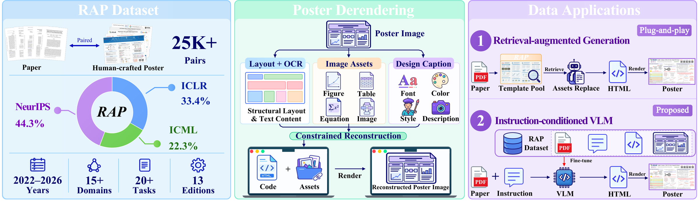
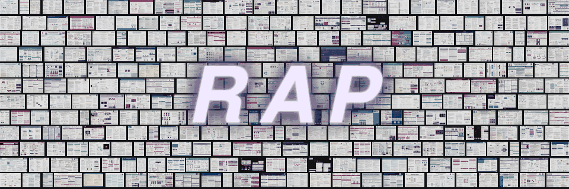
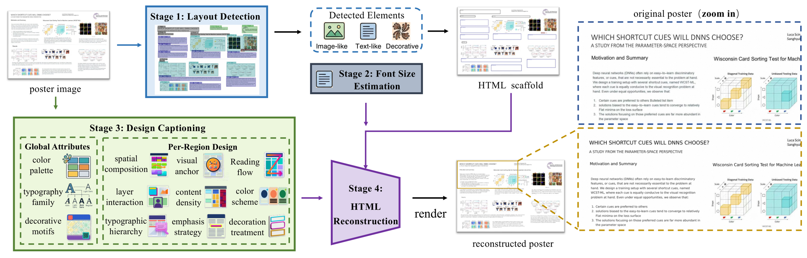
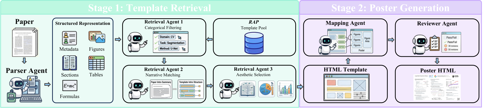
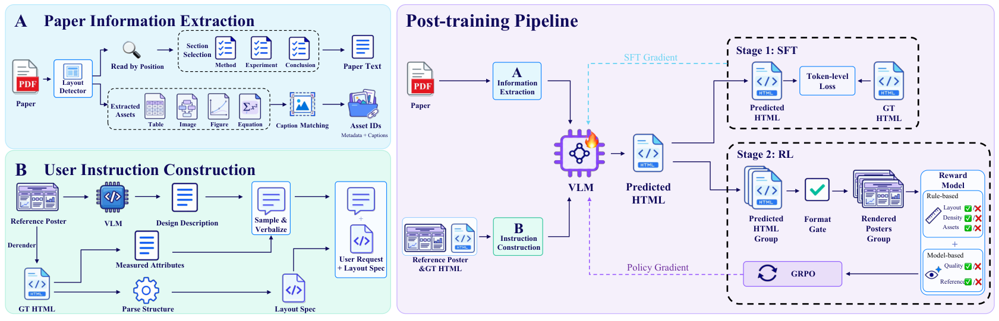
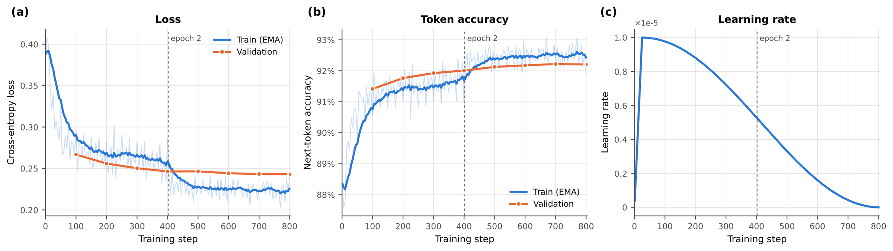
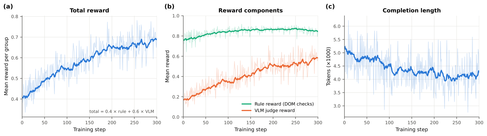

<div align="center">

# RAP: A Dataset for Paper-to-Poster Generation via Declarative Markup from Human-Crafted Exemplars

**[Haonan Han](https://scholar.google.com/citations?user=vLZp870AAAAJ&hl=en)**<sup>1,2</sup> &nbsp;
**[Yukang Lin](https://scholar.google.com/citations?user=DBt1fHQAAAAJ&hl=en)**<sup>1</sup> &nbsp;
**[Minliang Lin](https://scholar.google.com/citations?user=5T7Sqt0AAAAJ&hl=en&oi=ao)**<sup>2</sup> &nbsp;
**Haoxian Tan**<sup>2</sup> &nbsp;
**[Jun-Yan He](https://scholar.google.com/citations?user=bjNZqGAAAAAJ&hl=en)**<sup>2 ∗</sup> &nbsp;
**[Rui Yang](https://scholar.google.com/citations?user=Bi7e6bIAAAAJ&hl=en)**<sup>3</sup>
<br>
**[Zhi-Qi Cheng](https://scholar.google.com/citations?user=uB2He2UAAAAJ&hl=en)**<sup>4</sup> &nbsp;
**[Jie Hu](https://scholar.google.com/citations?user=DAJdHnkAAAAJ&hl=en)**<sup>2</sup> &nbsp;
**[Guanglu Wan](https://scholar.google.com/citations?user=NRG_hpYAAAAJ&hl=en&oi=ao)**<sup>2</sup> &nbsp;
**[Xiu Li](https://scholar.google.com/citations?user=Xrh1OIUAAAAJ&hl=en)**<sup>1 †</sup>

<sub><sup>1</sup> Tsinghua University &nbsp;&nbsp; <sup>2</sup> Meituan Longcat &nbsp;&nbsp; <sup>3</sup> The University of Hong Kong &nbsp;&nbsp; <sup>4</sup> University of Washington</sub>
<br><sub><sup>∗</sup> Project lead &nbsp;&nbsp; <sup>†</sup> Corresponding author</sub>

[](https://reconstruct-a-poster.github.io/)
[](https://huggingface.co/datasets/VincentHancoder/RAP)
[](https://huggingface.co/VincentHancoder/RAP-Qwen3.8-27B-RL)
[](https://huggingface.co/spaces/VincentHancoder/RAP)
[](LICENSE)



</div>

---

## Overview

Making a conference poster is visual coding in miniature: a whole paper has to be compressed onto one page, which
exercises summarization, visual design and code implementation at once. **RAP** turns this into a measurable task.

- **RAP-25K** — 25,435 paper–poster pairs from NeurIPS, ICLR and ICML (2022–2026), each with a three-level content
  taxonomy (15 domains / 20 tasks / 39 methods) and a distilled introduction summary.
- **Poster derendering** — a fully automated pipeline rewrites every human-crafted poster as styled HTML/CSS with typed,
  refillable slots, so each sample is a *paper–poster–markup* triplet that can be verified by rendering.
- **PosterRAG** — a training-free multi-agent pipeline that retrieves a human-crafted template and refills its slots
  without touching layout or styling.
- **RAP-Qwen3.8-27B-RL** — Qwen3.8-27B post-trained on the triplets with full-parameter SFT and GRPO.
- **RAP-150** — the held-out benchmark: 150 papers, 10 per domain, with the exact model inputs used in the paper.

## Repository layout

| Folder | What it does | Entry point |
|---|---|---|
| [`derender/`](derender/) | Poster image → HTML template (Layout Detection → Font Size Estimation → Design Captioning → HTML Reconstruction) | `python -m derender.run_derender --image poster.png --out out/` |
| [`posterrag/`](posterrag/) | PosterRAG: Parser → Retrieval (categorical, narrative, aesthetic) → Mapping → Reviewer agents over the RAP-25K template pool | `python -m posterrag.run_posterrag --pdf paper.pdf --out out/` |
| [`inference/`](inference/) | Paper parser, prompt construction, generation and rendering for RAP-Qwen3.8-27B-RL | `python -m inference.generate benchmark|pdf ...` |
| [`benchmark/rap_test150/`](benchmark/rap_test150/) | The 150 benchmark prompts with thumbnails, ids and metadata | — |
| [`figures/`](figures/), [`docs/`](docs/) | Paper figures used here; third-party notices | — |


## RAP-25K



| Conference | 2022 | 2023 | 2024 | 2025 | 2026 | Total |
|---|---:|---:|---:|---:|---:|---:|
| NeurIPS | 2,280 | 2,613 | 3,037 | 3,326 | – | **11,256** |
| ICLR | 830 | 877 | 1,447 | 2,085 | 3,265 | **8,504** |
| ICML | 882 | 1,471 | 1,751 | 1,571 | – | **5,675** |
| **Total** | 3,992 | 4,961 | 6,235 | 6,982 | 3,265 | **25,435** |

Each pair ships the poster image, the paper PDF, the annotations (`domain`, `task`, `method`, `keywords`,
`intro_summary`, title, abstract where available) and the derendered template (`layout.json`, `design_free.json`,
`generated.html` + `assets/`, `rendered.png`). The dataset card on Hugging Face documents the layout and loading.

## Poster derendering



Four stages turn a poster image into a template with typed, refillable slots: **Layout Detection** (LayoutLMv3
localizes title, text, figure, table, formula and caption regions and sorts them into text-like, image-like and
decorative elements), **Font Size Estimation** (PaddleOCR line grouping gives a CSS font size per text block),
**Design Captioning** (an MLLM describes the global palette, typography and motifs plus per-region design
dimensions) and **HTML Reconstruction** (an MLLM fills a pixel-exact scaffold with text, styling and the cropped image
assets; the result is rendered and compared with the original). The MLLM calls use your own API key — see
[`derender/README.md`](derender/README.md).

## PosterRAG



**Stage 1 — template retrieval.** A ParserAgent builds the paper's structured representation (metadata, sections,
figures, tables, formulas, taxonomy labels, introduction summary). RetrievalAgent-1 filters the pool by domain / task /
method, RetrievalAgent-2 re-ranks by narrative similarity of introduction summaries, RetrievalAgent-3 scores content
density, visualization ratio and scientific aesthetics and picks the final template (neutral by default, or weighted
by user preferences). **Stage 2 — poster generation.** The MappingAgent analyses the template's slots, maps paper
content onto them (replace / retain / clear) and fills them programmatically, leaving layout, typography and colours
untouched; the ReviewerAgent renders the result and fixes residual visual defects iteratively.
See [`posterrag/README.md`](posterrag/README.md).

## RAP-Qwen3.8-27B-RL



The same triplets supervise a dedicated model: paper information extraction and instruction construction produce the
training prompts; **Stage 1 (SFT)** trains on paper → poster-HTML pairs, **Stage 2 (RL)** optimizes rendered posters
with GRPO against rule-based checks and a VLM judge. Both stages are full-parameter (vision encoder frozen).

<p align="center">


</p>

```bash
pip install -r inference/requirements.txt && playwright install chromium
# the 150 benchmark papers, exactly as evaluated in the paper
python -m inference.generate benchmark --out outputs/rap_test150 --assets benchmark/rap_test150/assets
# any paper
python -m inference.generate pdf --pdf paper.pdf --out outputs/my_poster
```

Details, hardware requirements and the layout-detector environment: [`inference/README.md`](inference/README.md).
The benchmark inputs and how they were constructed: [`benchmark/rap_test150/README.md`](benchmark/rap_test150/README.md).

## License

This project is released under the [MIT License](LICENSE).

## Acknowledgements

RAP builds on [LayoutLMv3](https://github.com/microsoft/unilm/tree/master/layoutlmv3) and
[PDF-Extract-Kit](https://github.com/opendatalab/PDF-Extract-Kit) for layout detection,
[PaddleOCR](https://github.com/PaddlePaddle/PaddleOCR) for text recognition,
[Paper2Poster](https://github.com/Paper2Poster/Paper2Poster) and [Docling](https://github.com/docling-project/docling)
for paper parsing and template filling, [Qwen3.8-27B](https://huggingface.co/Qwen/Qwen3.8-27B) as the base model,
[ms-swift](https://github.com/modelscope/ms-swift) for post-training, and [Playwright](https://github.com/microsoft/playwright)
for rendering. Third-party licenses are listed in [`docs/THIRD_PARTY_NOTICES.md`](docs/THIRD_PARTY_NOTICES.md).

## Citation

```bibtex
@article{han2026rap,
  title   = {RAP: A Dataset for Paper-to-Poster Generation via Declarative Markup from Human-Crafted Exemplars},
  author  = {Han, Haonan and Lin, Yukang and Lin, Minliang and Tan, Haoxian and He, Jun-Yan and Yang, Rui and Cheng, Zhi-Qi and Hu, Jie and Wan, Guanglu and Li, Xiu},
  year    = {2026},
  note    = {Preprint}
}
```
